 

 

## 01 — About

<table>
<tr>
<td width="62%" valign="top">

### I design experiences — then bring them to life.

I'm an **Informatics Engineering** student at the **University of Technology Bahrain**, focused on **Front-End Development** and **UI/UX Design**.

I enjoy turning ideas into clear, intuitive digital products — from interface architecture and prototyping to responsive implementation. Alongside design and front-end work, I explore **AI, Computer Vision, Robotics, and Intelligent Systems** through technical projects and innovation challenges.

`USER-CENTERED DESIGN` · `FRONT-END` · `AI` · `ROBOTICS`

</td>
<td width="38%" valign="top">

### Currently exploring

✦ Human-centered intelligent systems  
✦ Interactive web experiences  
✦ AI & computer vision  
✦ Robotics & smart environments  
✦ Product and interface design

**Based in Bahrain 🇧🇭**

</td>
</tr>
</table>

---

## 02 — Featured Work

<table>
<tr>
<td width="33%" valign="top">

### 🎓 [UTB Informatics](https://github.com/Walaa2S/UTB-Informatics)

**University Experience Platform**

Interactive university platform with curriculum visualization, prerequisites, student progress, and university-focused experiences.

`Next.js` `React` `Tailwind` `Express` `MongoDB`

[**Explore project →**](https://github.com/Walaa2S/UTB-Informatics)

</td>
<td width="33%" valign="top">

### 🧠 [TECHTRAP](https://github.com/Walaa2S/TECHTRAP-PLATFORM)

**AI + Computer Vision**

Inclusive interactive platform using computer vision and body movement to create active learning experiences for children.

`AI` `Computer Vision` `Interactive UI`

[**Explore project →**](https://github.com/Walaa2S/TECHTRAP-PLATFORM)

</td>
<td width="33%" valign="top">

### 📊 [Baseera](https://github.com/Walaa2S/Baseera-)

**Data + AI**

AI-powered analytics platform that transforms complex datasets into organized insights and interactive dashboards.

`TypeScript` `AI` `Data Analytics`

[**Explore project →**](https://github.com/Walaa2S/Baseera-)

</td>
</tr>
</table>

---

## 03 — Tech & Design

<table>
<tr>
<td width="25%" valign="top">

### Front-End
React  
Next.js  
JavaScript  
TypeScript  
Tailwind CSS  
Framer Motion

</td>
<td width="25%" valign="top">

### UI/UX
Figma  
Wireframing  
Prototyping  
Responsive Design  
Design Systems  
User-Centered Design

</td>
<td width="25%" valign="top">

### Development
Python  
Java  
Node.js  
Express  
MongoDB  
Flutter

</td>
<td width="25%" valign="top">

### AI & Robotics
Artificial Intelligence  
Computer Vision  
Robotics  
Intelligent Systems

</td>
</tr>
</table>

---

## 04 — Highlights

<table>
<tr>
<td width="25%" align="center">

### 🏆
**1st Place**  
BisB Next-Gen Islamic  
Investment Hackathon 2026

</td>
<td width="25%" align="center">

### 📱
**Huawei**  
Student Ambassador

</td>
<td width="25%" align="center">

### 📸
**President**  
UTB Photography Club

</td>
<td width="25%" align="center">

### 🎓
**Informatics**  
Engineering · UTB

</td>
</tr>
</table>

---

## 05 — Philosophy

### “Design with purpose. Build with clarity. Create technology that feels human.”

**Front-End · UI/UX · AI · Robotics**

 

