 

 

## 01 — About

### I design experiences — then bring them to life.

I'm an **Informatics Engineering** student at the **University of Technology Bahrain**, focused on **Front-End Development** and **UI/UX Design**.

I turn ideas into clear, intuitive digital products — from interface architecture and prototyping to responsive implementation — while exploring **AI, Computer Vision, Robotics, and Intelligent Systems** through technical projects and innovation challenges.

**Based in Bahrain 🇧🇭**

---

## 02 — Featured Work

### [01 · UTB Informatics](https://github.com/Walaa2S/UTB-Informatics)

Interactive university platform with curriculum visualization, prerequisites, student progress, and university-focused experiences.

`Next.js` · `React` · `Tailwind CSS` · `Express` · `MongoDB` · `React Flow`

### [02 · TECHTRAP](https://github.com/Walaa2S/TECHTRAP-PLATFORM)

Inclusive interactive platform using computer vision and body movement to create active learning experiences for children.

`AI` · `Computer Vision` · `Interactive UI`

### [03 · Baseera](https://github.com/Walaa2S/Baseera-)

AI-powered analytics platform that transforms complex datasets into organized insights and interactive dashboards.

`TypeScript` · `AI` · `Data Analytics`

---

## 03 — Tech & Design

<table>
<tr>
<td width="25%" valign="top">

### Front-End
React  
Next.js  
JavaScript  
TypeScript  
Tailwind CSS  
Framer Motion

</td>
<td width="25%" valign="top">

### UI/UX
Figma  
Wireframing  
Prototyping  
Responsive Design  
Design Systems  
User-Centered Design

</td>
<td width="25%" valign="top">

### Development
Python  
Java  
Node.js  
Express  
MongoDB  
Flutter

</td>
<td width="25%" valign="top">

### AI & Robotics
Artificial Intelligence  
Computer Vision  
Robotics  
Intelligent Systems

</td>
</tr>
</table>

---

## 04 — Highlights

<table>
<tr>
<td width="33%" align="center">

### 🏆
**1st Place**  
BisB Next-Gen Islamic  
Investment Hackathon 2026

</td>
<td width="33%" align="center">

### 📱
**Huawei**  
Student Ambassador

</td>
<td width="33%" align="center">

### 📸
**President**  
UTB Photography Club

</td>
</tr>
</table>

---

## 05 — Connect

### Let's build something thoughtful.

  

### “Design with purpose. Build with clarity. Create technology that feels human.”

