<h3><code>Walaa Salah</code></h3>
<h3><code>walaa@github ~ $ ./contributions.sh</code></h3>

  

<h3><code>walaa@github ~ $ whoami</code></h3>
<table>
<tr>
<td valign="top"></td>
<td valign="top"></td>
</tr>
</table>

 

<h3><code>walaa@github ~ $ ls projects/</code></h3>

[UTB Informatics](https://github.com/Walaa2S/UTB-Informatics) · University Experience Platform  
[TECHTRAP](https://github.com/Walaa2S/TECHTRAP-PLATFORM) · AI & Computer Vision  
[Baseera](https://github.com/Walaa2S/Baseera-) · Data & AI Analytics

 

<h3><code>walaa@github ~ $ cat highlights.txt</code></h3>

1st Place · BisB Next-Gen Islamic Investment Hackathon 2026  
Huawei Student Ambassador · President, UTB Photography Club

 

<h3><code>walaa@github ~ $ ./connect.sh</code></h3>

[LinkedIn](https://www.linkedin.com/in/walaa-ali-33706a190) · [GitHub](https://github.com/Walaa2S)

 

Design with purpose · Build with clarity · Create technology that feels human

